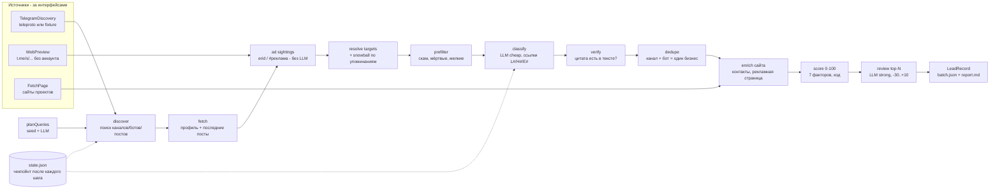

# lead-hunter

**English summary.** A standalone TypeScript module that finds B2B leads in *public* Telegram for a sales team. It discovers public channels, bots and Mini Apps (search, ad posts, mentions), has an LLM read them, **verifies every model claim against the source text with code** (quotes, links and contacts the model cannot prove are dropped), merges duplicate entities, computes an explainable 0-100 fit score, and exports evidence-first lead records in which every fact cites a source URL. It is read-only (no joins, no messages), resumable, and splits cleanly behind two small interfaces: `LlmClient` (any model provider) and `TelegramDiscovery` (live MTProto adapter or fixtures). `npm run demo` runs the whole pipeline on a synthetic world with no keys and no network. Extracted from a production monorepo; the live Telegram client is kept as an optional adapter and is **not exercised by this repo's tests**. Code was written with AI agents (Claude, Codex) under the owner's product direction, architecture and acceptance.

---

## 1. Проблема и для кого

Продавцу рекламного или «плати за действие» продукта в Telegram нужно знать, **кто уже тратит деньги на привлечение пользователей**: кто покупает рекламу в каналах, кто запускает рефералки, розыгрыши, Mini App. Вручную это сотни каналов, ботов и сайтов; готовые базы быстро устаревают и не содержат доказательств.

`lead-hunter` строит такой список автоматически и **с доказательствами**: каждое утверждение в лиде («покупает рекламу», «запустил реферальную программу», «есть платный тариф») привязано к цитате и публичной ссылке, откуда оно взято. Для кого: отдел продаж / соло-основатель, которому нужен проверяемый список рекламодателей с контактами и обоснованием оценки, а не «чёрный ящик».

Что именно продаётся и кого считать лидом — **конфиг** (`ProductProfile`), а не код.

## 2. Как устроено



Стадии (`src/pipeline.ts`): планирование запросов → поиск → загрузка профилей → извлечение рекламных размещений → резолв рекламируемых хендлов и «снежный ком» по упоминаниям → префильтр → классификация → дедупликация → обогащение сайта → скоринг → ревью → выгрузка. Состояние сохраняется после каждой единицы работы, повторный запуск с тем же `--run` пропускает сделанное.

Структура репозитория:

| Путь | Назначение |
|---|---|
| `src/pipeline.ts` | оркестрация стадий, лимиты (`DEFAULT_LIMITS`), чекпойнты |
| `src/classify.ts`, `src/text.ts` | промпт классификации, **верификатор** цитат/ссылок/контактов, детерминированное извлечение |
| `src/score.ts`, `src/dedupe.ts`, `src/ads.ts` | скоринг, склейка сущностей, рекламные размещения |
| `src/config.ts` | `ProductProfile`: что продаём, критерии лида, seed-запросы, офферы |
| `src/lead-record.ts`, `src/batch.ts` | схема выгружаемого лида и его сборка |
| `src/llm.ts` | интерфейс `LlmClient`, JSON-ответы с ретраем на другой модели, учёт токенов |
| `src/source.ts` | интерфейс `TelegramDiscovery` |
| `src/adapters/teleproto.ts` | живой клиент (опционально), `telegram-mappers.ts` — чистые мапперы |
| `src/adapters/fixture.ts`, `demo/` | фикстурный источник, «проигрыватель» ответов модели, синтетический мир |
| `src/adapters/openai-compatible.ts` | `LlmClient` поверх любого `/chat/completions` |
| `src/pacing.ts` | ограничитель частоты + обработка FLOOD_WAIT |

## 3. Ключевые решения

1. **Модель не пишет ссылки, хендлы и e-mail.** Код заранее извлекает их из публичного текста и нумерует (`L1`, `H2`, `E1`); модель только выбирает номера. Каждое утверждение про рекламу/рост/монетизацию должно сопровождаться дословной цитатой из указанного источника; цитата, которой нет в тексте (с учётом регистра, пробелов, «ё»), отбрасывается, а счётчик `droppedClaims` попадает в отчёт. Проверено тестами (`classification verification`) и в демо (одна намеренно выдуманная цитата отбрасывается).
2. **Самый сильный сигнал берётся без модели.** Если сущность является целью чужого рекламного поста (маркер `erid`, `#реклама`, `Реклама.` и т.п.), она по определению тратила деньги на привлечение. Из поста извлекаются хендл/домен цели и юридическое лицо с ИНН из строки «Рекламодатель: …».
3. **Скоринг — код, а не модель.** 7 факторов с максимумами 20/15/20/15/10/10/10 (product_fit, acquisition_need, ad_spend, activity, reachability, monetization, telegram_relevance), у каждого текстовое обоснование; размер аудитории намеренно второстепенен. Порог квалификации — 40 (`QUALIFY_THRESHOLD`). Сильная модель только пересматривает топ-N: может снизить оценку до −30 и поднять максимум на +10, видит только проверенные цитаты.
4. **Склейка только по жёстким признакам.** Один сайт продукта или взаимные ссылки профилей (плюс односторонняя ссылка при совпадающем имени). Общий рекламный контакт — не причина склеивать; при сомнении сущности остаются раздельными.
5. **Границы через интерфейсы.** `LlmClient.completion(prompt, options) -> text` и `TelegramDiscovery` — единственные точки контакта с внешним миром (плюс `FetchPage` для сайтов). Поэтому тесты и демо идут без сети и ключей.
6. **Нет бренда в коде.** Название продукта, критерии «хорошего» и «плохого» лида, seed-запросы, тексты офферов и приоритет действий — в `ProductProfile` (`config/product.example.json`, валидируется zod). Тест следит, что имя исходного продукта нигде не зашито.
7. **Выгружаемый лид валидируется.** Запись, у которой факт или контакт не ссылается на источник из списка `sources`, не выпускается, а попадает в `leadErrors`.
8. **Возобновляемость.** `state.json` пишется атомарно после каждого шага; повторный запуск не повторяет поиск/загрузку/классификацию/ревью (тест `is resumable`). Сущности, загруженные другими запусками, пропускаются, чтобы не тратить лимиты аккаунта.

### Безопасность и пейсинг: что подтверждено кодом

- **Read-only по построению.** Живой адаптер строит только запросы из списка `READ_ONLY_METHODS` (9 методов: `contacts.Search`, `contacts.ResolveUsername`, `channels.CheckSearchPostsFlood`, `channels.SearchPosts`, `channels.GetFullChannel`, `channels.GetChannels`, `users.GetFullUser`, `users.GetUsers`, `messages.GetHistory`). Тест сверяет этот список с исходником адаптера и проверяет отсутствие вызовов отправки/вступления. Люди не собираются: в стаб попадают только каналы, группы и боты с публичным именем.
- **Платный поиск не включается.** `allowPaidStars` не передаётся; поиск по постам сначала проверяет бесплатную квоту (`CheckSearchPostsFlood`) и останавливается, если она исчерпана. Отказ `PREMIUM_ACCOUNT_REQUIRED` завершает только этот этап, а не весь запуск.
- **Пейсинг** (`src/pacing.ts`, тесты `pacing.test.ts`): минимальная пауза между запросами, часовой потолок (режим `throw` или `wait`), FLOOD_WAIT: ждём указанное Telegram время с растущим множителем, не больше `maxRetries`, а слишком долгое ожидание (> `maxWaitSeconds`) прекращает этап вместо сна. Параметры в CLI `--live`: пауза 1800 мс, 1200 действий/час, режим `wait`, потолок FLOOD_WAIT 300 с (это значения из рабочего запуска, не рекомендация Telegram). Веб-превью читается не чаще 1 запроса/с.
- **Аудит** (опционально): адаптер сообщает только имя метода и исход; CLI пишет их в `audit.jsonl` без полезной нагрузки.
- Чего **нет**: в исходном монорепо был отдельный модуль `policy.ts` (deny-by-default для мутирующих действий QA-харнесса). Lead Hunter его **не использует**; гарантия read-only здесь — это фиксированный список методов, а не политика.

## 4. Результаты и цифры

Только то, что измерено или подтверждено источником:

| Что | Значение | Источник / как получено |
|---|---|---|
| Тесты | 52 passed в 4 файлах (unit + сквозной прогон на фикстурах) | `npm test` при подготовке этого репозитория |
| Typecheck, build | чисто | `npm run typecheck`, `npm run build` |
| Демо на синтетическом мире | 11 кандидатов → 10 загружено → 2 отсеяно префильтром → 8 классифицировано → 7 бизнесов (1 склейка канал+бот) → 4 квалифицированы → 4 валидных лида, 0 ошибок; 1 выдуманная цитата отброшена | `npm run demo`, воспроизводимо (фиксированное «сейчас», записанные ответы модели) |
| **274 лида, запуск 2026-10-11 02:53** | один плановый запуск на VPS | **Источник: `STATUS_REPORT.md` исходного монорепо (строка «Lead Hunter»), ссылающаяся на `journalctl` сервиса `gq-leads` на VPS. Я не перепроверял журнал и содержимое этих лидов; качество (точность, конверсия в сделки) не измерялось.** |

Чего в цифрах **нет**: точности/полноты классификации, доли лидов, ставших клиентами, стоимости запуска. Демо-модель — это записанные ответы, она проверяет механику, а не качество модели.

## 5. Ограничения и что дальше

**Ограничения (честно):**

- **Живой Telegram в этом репозитории не проверялся.** Адаптер `teleproto` — рабочий код из монорепо (там он запускался по расписанию), но здесь его тесты не касаются сети; юнит-тестами покрыты только чистые мапперы и список методов.
- Качество LLM не измерено: нет размеченной выборки, нет precision/recall. Верификатор гарантирует, что цитата есть в тексте, но не что вывод по ней верен.
- Веса скоринга и порог 40 заданы вручную, не калибровались по конверсии.
- Детектор рекламы заточен под российский рынок (`erid`, «Рекламодатель: … ИНН …»); английская строка рекламодателя не разбирается. Seed-запросы смесь русского и английского.
- Разбор `t.me/s/...` и `t.me/<name>` — регулярные выражения по классам вёрстки; это хрупко при смене разметки. В исходном монорепо тесты шли на реальных снимках страниц (2026-09-24); сюда они не перенесены (чужие публичные данные), здесь тесты используют вручную написанный HTML той же формы.
- Фабрика браузера для JS-сайтов (`--browser`, нужен опциональный `playwright`) здесь не запускалась.
- `OpenAI-compatible` адаптер проверен только со stub-`fetch`; с реальным провайдером не запускался.
- Обогащение сайта может вернуть собственный Telegram-хендл лида как «general»-контакт (наблюдается в демо).
- Сессия Telegram передаётся готовой строкой в окружении; в исходном монорепо использовалось шифрованное хранилище сессий с парольной фразой, оно сюда не перенесено. Авторизации модуль не делает.
- Нет интеграции с CRM и базы данных: выход — JSON/Markdown на диске. (В монорепо отдельная команда импортировала батч в CRM; она не часть этого модуля.)
- Состояние — один JSON-файл, без блокировок: параллельные запуски с одним `--run` не поддерживаются.

**Что дальше:** размеченный набор для оценки классификатора и калибровки скоринга; проверка живого адаптера на отдельном тестовом аккаунте; локализация детекторов рекламы под другие рынки; отчёт о доле отброшенных цитат по моделям; хранилище состояния помимо файла.

### Откуда взят код

Исходник: `tools/tg-harness/src/lead-hunter` монорепо. Сравнивались ветки `test-launch` и `vps/gqtools-2026-10-11` (коммит `66236e9`, merge `cf/sales`; по `STATUS_REPORT.md` tools-хост на VPS стоит на этом же коммите). Разница по lead-hunter вместе с тестами и фикстурами: 16 файлов, +1884/−73 — веб-превью `t.me/s/` (новый `webpreview.ts`), снежный ком по упоминаниям, пропуск сущностей из прошлых запусков, доработки поиска по постам и пайплайна. **Взята более свежая версия `66236e9`.** Рабочая копия на VPS могла отличаться ещё и незакоммиченными правками (`STATUS_REPORT.md` упоминает «грязный» `model-pool.json` на tools-хосте); VPS я не открывал.

Что изменено при выделении: убраны `@giftquest/*` (каноникализация хендлов/доменов скопирована в `src/canonical.ts`, схема лида — `src/lead-record.ts`), модель за `LlmClient`, Telegram за `TelegramDiscovery`, продукт и офферы в конфиг, тексты фактов лида переведены на английский, удалены учёт Stars и шифрованное хранилище сессий; добавлены фикстурный источник, демо, тесты на конфиг/границы/read-only. Логика классификации, верификации, скоринга и склейки не менялась.

## 6. Как запустить

Нужен Node.js 22+.

```bash
npm install
npm test            # 52 теста, без сети
npm run typecheck
npm run build
npm run demo        # весь пайплайн на фикстурах, без ключей; результат в output/demo/demo/
```

`npm run demo` печатает воронку, квалифицированные лиды и причины отказа и пишет `batch.json` (валидные лиды), `report.md`, `report.json`, `state.json`.

### Запуск с реальными ключами

1. Скопируйте `.env.example` в `.env` и заполните (не коммитьте). Для модели нужен любой OpenAI-совместимый endpoint: `LLM_BASE_URL`, `LLM_API_KEY`, `LLM_MODEL_CHEAP` (и `LLM_MODEL_STRONG` для ревью). Загрузите переменные в окружение любым способом (например, `node --env-file=.env`).
2. Свой продукт: скопируйте `config/product.example.json`, отредактируйте и передайте `--profile`.
3. Без Telegram-аккаунта (только веб-превью и сайты):

   ```bash
   node --env-file=.env --import tsx src/bin.ts --run test1 --profile my-product.json
   ```

4. С аккаунтом Telegram (**read-only, но это ваш аккаунт: используйте отдельный**): заполните `TELEGRAM_API_ID`, `TELEGRAM_API_HASH` (с my.telegram.org) и `TELEGRAM_SESSION` (заранее авторизованная StringSession) и добавьте `--live`. Поиск по постам может требовать Telegram Premium (адаптер обрабатывает отказ `PREMIUM_ACCOUNT_REQUIRED` как остановку этапа). Помните, что живой адаптер здесь не проверялся.

Лимиты: `--limit maxFetch=100 --limit maxClassify=50` и др. (см. `DEFAULT_LIMITS` в `src/pipeline.ts`).

### Подключение model-pool через адаптер (пример, не импортируется)

Интерфейс один: `completion(prompt, options) -> text | {text, route, usage}`; при невозможности ответить бросьте `LlmUnavailableError(message, exhausted)`. Пример поверх пула моделей с методом `complete({role, prompt, maxTokens, ...})` (форма API взята из исходного монорепо; **сверьте сигнатуры реального пакета `portfolio/model-pool`**, в этом репозитории он не используется):

```ts
import { type LlmClient, LlmUnavailableError } from "lead-hunter";
import type { ModelPool } from "model-pool"; // пример, не зависимость

export function poolAsLlm(pool: ModelPool): LlmClient {
  return {
    async completion(prompt, { tier, maxTokens, avoid }) {
      const strong = tier === "strong";
      const result = await pool.complete({
        role: strong ? "research" : "summarization",
        prompt,
        maxTokens,
        timeoutMs: strong ? 120_000 : 60_000,
        ...(avoid?.length ? { avoid: [...avoid] } : {}),
      });
      if (!result.ok)
        throw new LlmUnavailableError(
          `${result.reason}: ${result.message}`,
          result.reason === "all_exhausted",
        );
      return {
        text: result.text,
        route: `${result.provider}/${result.model}`,
        usage: result.usage,
      };
    },
  };
}
```

`avoid` содержит маршруты (`provider/model`), которые только что вернули мусор: пул может переключить повтор на другую модель. `exhausted: true` останавливает классификацию в этом запуске, чтобы не жечь квоты.

## 7. Моя роль

Продуктовая постановка (какой лид считается ценным, что считается доказательством, что можно и нельзя делать с аккаунтом), архитектура (границы интерфейсов, принцип «модель выбирает, код проверяет», read-only), приёмка (критерии готовности, проверка результата, решение о том, что считать подтверждённым). Код написан с помощью ИИ-агентов (Claude, Codex) под управлением владельца репозитория.
